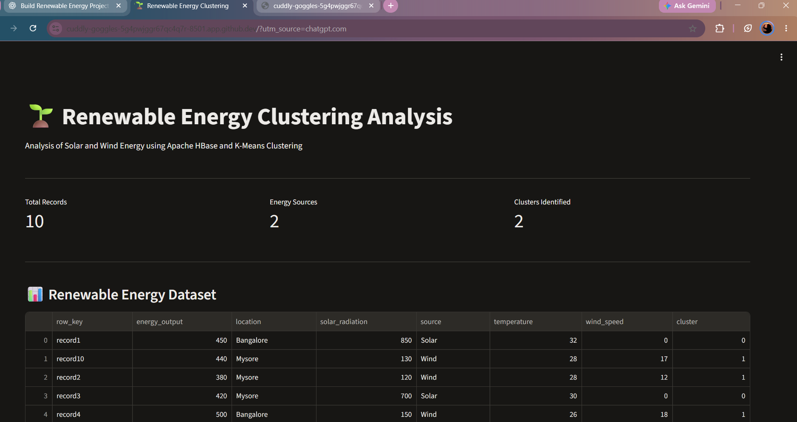
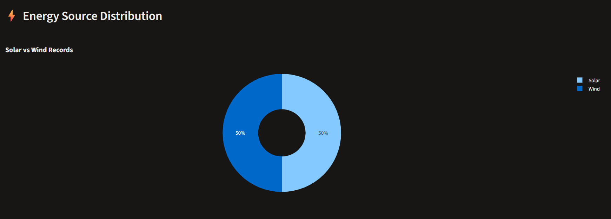
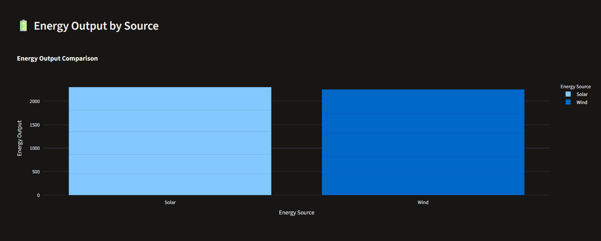

# 🌱 Renewable Energy Clustering Analysis using Apache HBase

## 1. Project Overview

This project focuses on analyzing renewable energy measurements
from Solar and Wind energy sources using Apache HBase and
Machine Learning.

Apache HBase is used to store renewable energy data.
Python retrieves and preprocesses the data, and the K-Means
Clustering algorithm groups similar energy records.

A Streamlit dashboard displays the dataset, clustering results
and visualizations.

## 2. Objectives

- Store renewable energy data using Apache HBase.
- Retrieve data using Python and HappyBase.
- Preprocess data using Pandas.
- Apply K-Means clustering using Scikit-learn.
- Visualize results using Streamlit and Plotly.

## 3. Technologies Used

| Technology | Purpose |
|---|---|
| Apache HBase | NoSQL database |
| Docker | Run HBase |
| Python | Data processing |
| HappyBase | Connect Python with HBase |
| Pandas | Data preprocessing |
| Scikit-learn | K-Means clustering |
| Streamlit | Dashboard development |
| Plotly | Data visualization |

## 4. System Architecture

1. Renewable energy measurements are stored in Apache HBase.
2. HappyBase connects Python with HBase.
3. Pandas retrieves and preprocesses the records.
4. Scikit-learn applies K-Means clustering.
5. Streamlit displays the results.
6. Plotly generates interactive visualizations.

## 5. Project Structure

```text
renewable-energy-clustering/
│
├── backend/
│   ├── hbase_connection.py
│   ├── data_preprocessing.py
│   └── clustering.py
│
├── dataset/
│
├── docker/
│   ├── Dockerfile
│   ├── docker-compose.yml
│   └── hbase-site.xml
│
├── frontend/
│   └── app.py
│
├── outputs/
│
├── requirements.txt
└── README.md

## 6. Dataset Description

The project uses illustrative sample measurements containing 10 records.

The dataset includes:

- Energy source (Solar/Wind)
- Location (Bangalore/Mysore)
- Solar radiation
- Wind speed
- Temperature
- Energy output

**Note:** These are sample values and not real-time sensor readings.

## 7. Clustering Algorithm

K-Means clustering is used to group similar renewable energy measurements.

The numerical features used are:

- Solar radiation
- Wind speed
- Temperature
- Energy output

StandardScaler is used to standardize the numerical features.

The algorithm is configured with 2 clusters.

## 8. Dashboard Features

The Streamlit dashboard displays:

- Total number of records
- Number of energy sources
- Number of clusters identified
- Renewable energy dataset
- Cluster distribution bar chart
- Energy source distribution pie chart
- Energy output comparison chart

### Dashboard Screenshots

#### Dashboard Overview



#### Cluster Distribution



#### Energy Visualizations



## 9. How to Run the Project

### Step 1: Clone the repository

```bash
git clone https://github.com/Varsha-mahadevappa/renewable-energy-clustering.git
cd renewable-energy-clustering
```

### Step 2: Start Apache HBase

```bash
docker compose -f docker/docker-compose.yml up -d --build
```

### Step 3: Create a Python virtual environment

```bash
python3.12 -m venv .venv
source .venv/bin/activate
```

### Step 4: Install dependencies

```bash
pip install -r requirements.txt
```

### Step 5: Start the dashboard

```bash
streamlit run frontend/app.py --server.address 0.0.0.0 --server.port 8501
```

Make sure the HBase table is created and populated before starting the dashboard.

## 10. Expected Results

The dashboard displays 10 sample records, 2 energy sources and 
2 clusters.

The clustering results and visualizations help understand patterns in the sample renewable energy measurements.

## 11. Conclusion

This project demonstrates how Apache HBase can be integrated with Python and Machine Learning for renewable energy data analysis.

It combines NoSQL data storage, data preprocessing, K-Means clustering and interactive visualization in a single application.
